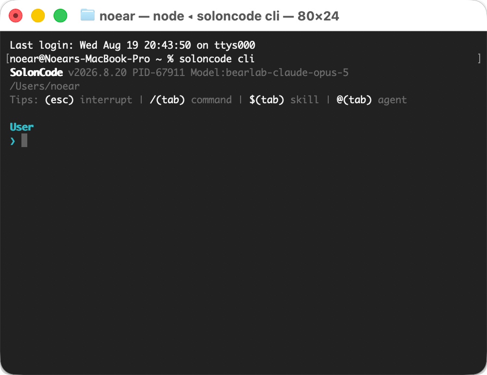
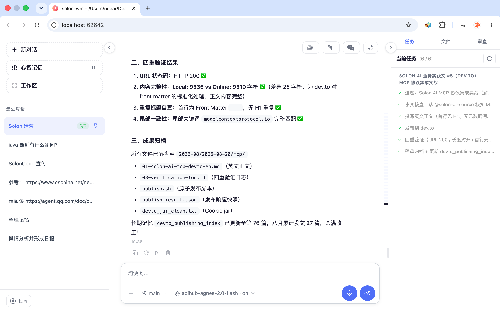
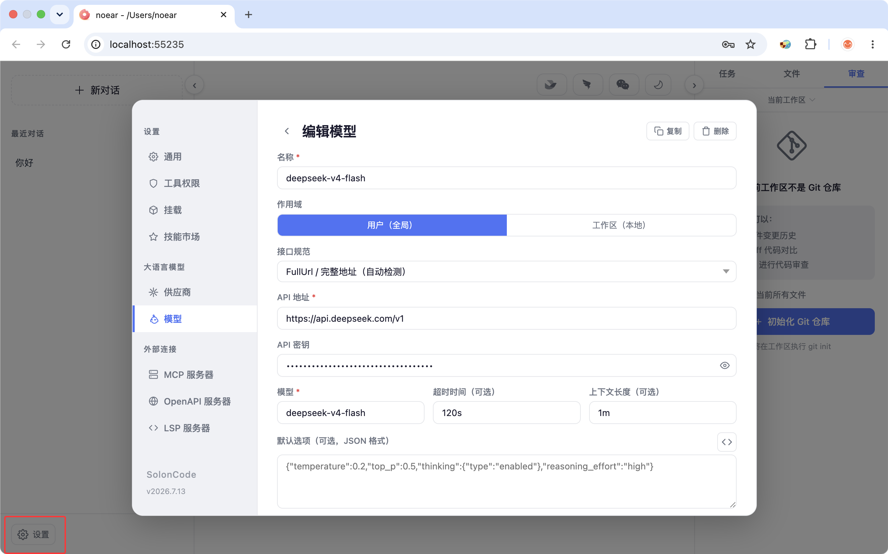

<div align="center">
<h1>SolonCode</h1>
<p>基于 <a href="https://github.com/opensolon/solon-ai">Solon AI</a> 与 Java 实现的开源编码智能体（支持 Java8 到 Java26 环境启动）</p>
<p>最新版本：v2026.11.28</p>


<br />

</div>

<div align="center">

[中文](README.zh-CN.md) | [繁體中文](README.zh-TW.md) | [日本語](README.ja.md) | [한국어](README.ko.md) | [Deutsch](README.de.md) | [Français](README.fr.md) | [Español](README.es.md) | [Italiano](README.it.md)

[Русский](README.ru.md) | [العربية](README.ar.md) | [Português (BR)](README.br.md) | [ไทย](README.th.md) | [Tiếng Việt](README.vi.md) | [Polski](README.pl.md)

[বাংলা](README.bn.md) | [Bosanski](README.bs.md) | [Dansk](README.da.md) | [Ελληνικά](README.gr.md) | [Norsk](README.no.md) | [Türkçe](README.tr.md) | [Українська](README.uk.md)

</div>

## 安装与配置

安装：

```bash
# Mac / Linux / Harmony PC:
curl -fsSL https://solon.noear.org/soloncode/setup.sh | bash

# Windows (PowerShell):
irm https://solon.noear.org/soloncode/setup.ps1 | iex
```

修改配置（新用户推荐先用 Web 设置页配置：）：

```
soloncode web
```

进入页面后打开“设置 -> 大语言模型”，添加模型并测试连接。



## 运行

在控制台"任意"目录（即工作区）下，运行 `soloncode cli`（cli 交互）或者 `soloncode web`（web 交互） 命令即可。

* `soloncode`（cli 交互）

```bash
demo@MacBook-Pro ~ % soloncode cli
SolonCode v2026.11.28 PID-87950 Model:deepseek-v4-flash
/Users/demo
Tips: (esc) interrupt | /(tab) command | $(tab) skill | @(tab) agent

User
❯ 
```

* `soloncode web`（web 交互）

```bash
demo@MacBook-Pro ~ % soloncode web
SolonCode v2026.11.28 PID-73617 Model:deepseek-v4-flash
/Users/demo
2026-07-09 11:26
Web interface: http://localhost:4808/
```

效果测试（分别尝试以下任务，从简单到复杂）：

* `你好`
* `用网络分析下 ai mcp 协议，然后生成个 ppt` //最好提前安装些 skill
* `帮我设计一个 agent team（设计案存为 demo-dis.md），开发一个 solon + java17 的经典权限管理系统（demo-web），前端用 vue3，界面要简洁好看`


## SolonCode 桌面版

SolonCode Desktop 是 SolonCode 的本地 IDE 形态，将 Agent 对话、项目文件、Monaco 编辑器、终端、Git 变更和任务执行集中在同一个工作区。桌面客户端使用 Tauri、React 和 TypeScript 构建，Java CLI 后端负责 Agent 运行时、模型访问和工具调用。

桌面版特性：

* **Agent 工作模式** — 支持审批执行、自动编辑、只读规划和持续 Goal 执行。
* **项目级对话** — 支持图片与文件附件、工作区上下文、运行中追加任务，以及每条回答的模型、Token 和耗时统计。
* **可靠会话** — 支持历史持久化、长期记忆、回退、重做、安全删除和工作区检查点。
* **完整开发工作台** — 集成文件管理、代码编辑器、终端、Git、任务列表、Skills、Agents、MCP、OpenAPI、LSP 和自动化。

从源码运行桌面端时，需要单独启动后端：

~~~bash
# 终端 1：桌面后端
soloncode serve 4808

# 终端 2：桌面客户端
cd soloncode-desktop
npm install
npm run tauri:dev
~~~

开发模式连接 4808 端口，不会自动启动或探测后端进程。更多内容请查看 [Desktop README](soloncode-desktop/README.md) 和 [SolonCode Desk 入门指南](docs/soloncode-desk-getting-started.md)。

## ACP 协议（编辑器接入）

SolonCode 支持 ACP（Agent Client Protocol）v1，通过 stdio 与 Zed、JetBrains 等编辑器/客户端对接：

```bash
soloncode acp
# 或
java -jar soloncode-cli.jar acp
```

启动后 stdout 仅承载 JSON-RPC 报文（日志、更新检查等一律走 stderr），客户端按 ACP v1 完成 `initialize` 握手后即可创建会话。

实时推理中，思考增量通过 `agent_thought_chunk` 回传，正文增量通过 `agent_message_chunk` 回传，工具按调用 ID 发送开始和结果。关闭思考只影响思考流，不会隐藏正文；轮次结束不会重复发送已经流出的正文。`usage_update` 回传当前上下文的估算 Token 数和模型窗口大小（包括压缩后的变化），不代表累计用量或费用。

ACP 与终端 CLI 共用 SolonCode 的会话执行和持久化逻辑；每个 ACP 对话使用自己的 `sessionId`。新一轮提问不会额外把上一轮的原始工具调用和结果注入模型上下文。`session/load` 使用同一会话的 `last-trace`，在最后一条答复前回放最近一轮可恢复的思考和已结束的工具调用，不重复输出答复。`session/resume` 不回放。

**会话配置项（configOptions）**

`session/new`、`session/load`、`session/resume` 的响应在 `configOptions` 字段里发布四个会话级选择器，客户端可用 `session/set_config_option` 随时修改（轮次进行中不可改）：

| id | 类别 | 可选值 | 说明 |
| --- | --- | --- | --- |
| `model` | `model` | 已启用的模型 | 会话级模型选择，回落顺序：会话选择 → 默认模型 → 第一个启用模型 |
| `effort` | `thought_level` | `auto` + 当前模型支持的推理档 | 推理强度；`auto` 不注入，交由模型默认 |
| `_soloncode_thinking_mode` | `_soloncode_thinking_mode` | `auto` / `on` / `off` | 思考模式开关，独立于推理强度（自定义类别，非标准 ID） |
| `mode` | `mode` | `ask` / `reject`（启用 HITL 时）；`configured`（未启用） | ACP 侧对 HITL 审批卡的处置方式 |

**斜杠命令**

创建、加载或恢复会话时，SolonCode 通过标准 `available_commands_update` 广播可用指令。在 ACP 客户端中输入 `/help` 查看列表、`/model` 列出或切换当前会话模型、`/continue` 续跑仍未结束的上次轮次（不撤回已完成答复）。与引擎工作区一致时，也可运行已加载的 Markdown 自定义命令。依赖终端、改写历史或调度后台任务的命令不会发布。

**审批与权限**

工具审批沿用 SolonCode 的 HITL 体系（`general.hitlEnabled` 及既有工具/权限规则，ACP 不会放宽或绕过）：

* `ask`（默认）：每张挂起卡向客户端发 `session/request_permission`（提供 `allow-once` / `reject-once`）；答复 `allow-once` 才批准，其余一律按拒绝处理；答复 `cancelled` 则整轮停止、本批卡按「拒绝、不续流」收尾。
* `reject`：不询问客户端，挂起卡直接拒绝。
* `configured`：HITL 未启用时的唯一取值，表示由服务端策略决定，并非对外开放的「绕过审批」开关。

**会话恢复范围**

* `session/load` 会校验会话 ID 归属（仅限本端发放的 `acp-` 前缀 ID 形态），把磁盘历史回放为 `session/update`（用户文本、助手思考与正文、按调用 ID 配对的工具卡），并绑定工作目录；请求目录与已绑定工作区不一致时按参数错误拒绝，活跃会话不会被静默改挂到别的目录。
* `session/resume` 做同样的认领校验但不回放历史，适合本地已持有对话上下文的客户端。
* `cwd` 仅接受存在的绝对目录（支持 `file://` URI 与 Windows 路径），相对或非法路径一律拒绝，不会回落到进程目录。
* 客户端经 `mcpServers` 传入的 MCP 配置当前**不生效**（能力声明里 http/sse 均不广告，不假装实现了完整的 MCP 客户端侧协议）；本机配置的 MCP 工具照常可用。不支持的块类型（如 audio）同样不广告。

## 文档

更多配置说明请查看我们的 [官方文档](https://solon.noear.org/article/soloncode)。

## 参与贡献

如有兴趣贡献代码，请在提交 PR 前阅读 [贡献指南 (Contributing Docs)](https://solon.noear.org/article/623)。

## 基于 SolonCode 进行开发

如果你在项目名中使用了 "soloncode"（如 "soloncode-dashboard" 或 "soloncode-app"），请在 README 里注明该项目不是 OpenSolon 团队官方开发，且不存在隶属关系。

## 常见问题：和 Claude Code 有什么不同？

功能上很相似，关键差异：

* 采用 Java 实现，100% 开源。兼容毕昇 JDK（Huawei BiSheng JDK），兼容鸿蒙 PC（Huawei Harmony PC）。
* 纯中文提示词驱动与构建。
* 不绑定特定提供商。按需配置模型。模型迭代会缩小差异、降低成本，因此自由配置很重要。
* 同时支持终端命令行界面 (CLI)、浏览器界面（WEB）、桌面IDE界面（Desktop）。
* 支持 Web，ACP 协议进行远程通讯。
